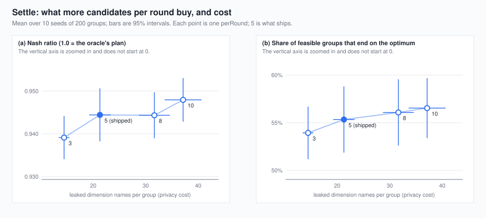

# Evaluation

Settle's claim is that a group can settle on a restaurant and a time without anyone's budget, availability or dietary rules leaving their own assistant: the mediator only hears *accept / reluctant / reject* plus at most one dimension name per answer. This chapter measures what that costs: how often the protocol finds a plan, how good it is against a planner that may read everything, and how many dimension names it collects on the way. All numbers come from `sim/out/report.md` and `report.json` (200 synthetic groups, seed 1), produced by the harness in `sim/`.

## Setup

**Synthetic people.** Each person is drawn by `sim/synth.ts` from a seeded PRNG (`sim/rng.ts`, mulberry32). Availability is all five weekend slots with probability 0.45, otherwise 2 to 4 of them; budget ceiling uniform in $18–65 with a $0–15 stretch; maximum travel 8–35 minutes; 18% carry one dietary rule (no spicy, vegetarian, no seafood, halal). Each person likes 0–2 cuisines, dislikes 0–2 others, has random normalised weights over budget / travel / cuisine and a random concession order. These `Constraints` go through the production `compile()` into the same `Preferences` contract the app uses: hard rules for time, diet, price (budget + flex) and distance (travel + 10 min grace); soft rules for price, distance and cuisine.

**Restaurant pools.** Every group gets a fresh pool of 30 restaurants with random cuisine, price ($12–70, skewed cheap), travel (4–35 min), the four dietary flags, and opening slots (60% all five, 25% dinners only, 15% lunches only). A candidate is a (restaurant, open slot) pair; groups in this run had 105–140 candidates each (mean 121.9).

**Groups.** 200 groups of 3 to 6 people (51 / 46 / 44 / 59 groups of size 3 / 4 / 5 / 6). Everything is a pure function of the seed; `runSim` is tested to be byte-for-byte deterministic.

**Protocol parameters.** The defaults from `negotiate()`: at most 6 rounds of 5 candidates; from round 4 every assistant is asked to concede one more step (level = round − 3), which loosens soft rules only; when a round contains unanimously accepted candidates, the top 3 become finalists, each assistant returns a 1–5 utility bucket for them, and the plan with the highest Nash product of buckets wins (ties: best worst-off bucket, then more accepts).

## Baselines

**Oracle** (`sim/oracle.ts`). The no-privacy upper bound: enumerate every candidate, score it with every member's true level-0 `utility()`, drop hard-rule violations, keep the best Nash product and the best max-min.

**Naive** (`naivePick` in `sim/metrics.ts`). The round-1 candidate with the most accepts (ties: fewest reluctant), taken as-is; if anyone rejected it, it counts as no plan. This stands in for "post five options in the chat and go with the most thumbs-up".

**LLM, no privacy** (`sim/llm-baseline.ts`). Claude is given every member's preference JSON verbatim plus the full candidate list (price, travel, cuisine, flags, slot), together with the exact scoring semantics, and asked for one plan through a forced `pick_plan` tool call (`{restaurantId, slot}`). The pick is validated against the candidate pool and scored with the true utilities like the other methods; an invalid pick or a hard-rule violation counts as no plan. It runs with `--llm-baseline` on the first `--llm-groups` groups (default 40) when `ANTHROPIC_API_KEY` is set. It is key-gated and **was not run for this report**, so no LLM numbers are reported here; when it has run, `report.md` gains an "LLM baseline" section that compares all methods on exactly the groups that had the call.

## Metrics

Per group (`sim/metrics.ts`):

- **Convergence**: status `agreed` (everyone accepted), `compromise` (nobody rejects but not everyone accepts), or `no_deal`.
- **Rounds to agreement**: the round in which unanimous acceptance happened.
- **Nash ratio**: product of true utilities of the chosen plan divided by the oracle's best product. **Max-min ratio**: the same for the worst-off member. Both are `undefined` when the oracle itself found nothing (nothing to compare against) and 0 when the oracle found a plan but the method did not.
- **Hits optimum**: the chosen plan's Nash product equals the oracle's (ratio ≥ 1 − 10⁻¹²).
- **Leaked dimension names**: `leakedDims`, the total number of dimension names the mediator saw, and `leakedDims / (size × rounds)` per person per round. A second counter, `observedDims`, wraps every agent and counts what it actually returned, independently of what `negotiate()` reports.

Regret is computable here only because we generated the people: in the real system the utilities never leave the assistants, but in the harness we hold every `Preferences` file and can call `utility()` ourselves. The oracle is that ability applied to every candidate, and 1 − Nash ratio is normalised regret.

## Results

Table 1, from `sim/out/report.md` (ratios are mean / median over the groups where the oracle found a feasible plan):

| group | n | agreed | any plan | oracle feasible | agreed given feasible | plan given feasible | Nash ratio protocol | Nash ratio naive | max-min ratio protocol | max-min ratio naive | hits optimum | leaked dims (mean) | leaked / person / round |
|---|---:|---:|---:|---:|---:|---:|---:|---:|---:|---:|---:|---:|---:|
| all | 200 | 74% | 75% | 75% | 99% | 100% | 0.930 / 0.999 | 0.455 / 0.566 | 0.959 / 1.000 | 0.477 / 0.742 | 50% | 36.9 | 2.15 |
| size 3 | 51 | 92% | 92% | 92% | 100% | 100% | 0.931 / 0.976 | 0.615 / 0.846 | 0.960 / 1.000 | 0.645 / 0.894 | 47% | 13.9 | 2.10 |
| size 4 | 46 | 87% | 87% | 87% | 100% | 100% | 0.912 / 0.951 | 0.361 / 0.000 | 0.946 / 0.999 | 0.385 / 0.000 | 35% | 23.0 | 1.97 |
| size 5 | 44 | 61% | 66% | 66% | 93% | 100% | 0.948 / 1.000 | 0.517 / 0.765 | 0.965 / 1.000 | 0.530 / 0.779 | 62% | 45.8 | 2.27 |
| size 6 | 59 | 58% | 58% | 58% | 100% | 100% | 0.933 / 1.000 | 0.293 / 0.000 | 0.967 / 1.000 | 0.310 / 0.000 | 62% | 61.1 | 2.26 |

Figure 1 (`sim/out/report.svg`) plots the mean Nash ratio per group size for naive and protocol against the oracle line at 1.0 (panel a), and the rounds-to-agreement histogram (panel b).

**Feasibility.** The oracle found a plan in 150 of 200 groups, and the 50 `no_deal` outcomes are exactly the 50 infeasible groups: the protocol never gave up on a solvable one. Feasibility falls with size (92% at 3 people, 58% at 6), a property of the generator, so the columns conditioned on oracle feasibility are the ones to read.

**Quality.** Given a feasible group, the protocol produced a plan 100% of the time and unanimous acceptance 99% of the time (148 of 150; the other two are compromises). Its plans keep 93% of the oracle's Nash welfare on average, the median group loses almost nothing (0.999), and the worst-off member keeps 96% of what the oracle could give them. Exactly half the feasible groups (75 of 150) end on the optimum; only 5 fall below a 0.7 Nash ratio (lowest 0.53). Naive finds a feasible plan in only 77 of 150 groups and hits the optimum in 25; its median Nash ratio is 0 at sizes 4 and 6 because the most-voted round-1 option is usually rejected by someone.

**Rounds.** Of the 148 agreements, 75 came in round 1 and 60 in round 2 (135 of 148, 91.2%); rounds 3–6 account for 1, 3, 3 and 6. Both compromises ran all 6 rounds at concession level 3. Mean rounds run is 2.87 (median 2), from 1.78 at 3 people to 3.86 at 6, the latter inflated by infeasible groups running the full 6 rounds.

## Across seeds and candidates per round

Table 1 is one draw of 200 groups. The tables below repeat it over ten seeds and over four values of `perRound`. They are generated by `npm run sim:study` (`sim/study.ts`); do not edit them by hand.

<!-- prettier-ignore-start -->
<!-- generated:study:start -->

10 seeds (1 to 10), 200 synthetic groups per seed, 30 restaurants per group. Each seed gives one value per metric; the table reports the mean across seeds and a 95% Student-t interval (9 degrees of freedom).

**Across seeds** (protocol as shipped, 5 candidates per round)

| metric | mean [95% interval] | range across seeds |
|---|---:|---:|
| agreement rate | 75.8% [74.0%, 77.5%] | 70.0% to 78.5% |
| agreement rate, feasible groups | 98.8% [98.4%, 99.3%] | 97.4% to 99.4% |
| Nash ratio, protocol | 0.944 [0.938, 0.951] | 0.930 to 0.958 |
| max-min ratio, protocol | 0.969 [0.965, 0.973] | 0.959 to 0.981 |
| hits the optimum | 55.2% [51.8%, 58.5%] | 48.3% to 61.5% |
| Nash ratio, naive | 0.438 [0.412, 0.464] | 0.373 to 0.488 |
| leaked dimension names per group | 34.25 [32.39, 36.12] | 29.50 to 38.78 |
| leaked names per person per round | 2.14 [2.10, 2.17] | 2.06 to 2.22 |
| rounds run | 2.77 [2.69, 2.86] | 2.59 to 3.02 |

**Candidates per round** (`perRound`), mean [95% interval] across the same seeds

| perRound | agreement rate, feasible groups | Nash ratio, protocol | max-min ratio, protocol | hits the optimum | leaked dimension names per group | leaked names per person per round | rounds run |
|---:|---:|---:|---:|---:|---:|---:|---:|
| 3 | 98.8% [98.3%, 99.3%] | 0.939 [0.930, 0.947] | 0.964 [0.958, 0.971] | 54.2% [50.1%, 58.3%] | 20.29 [19.26, 21.33] | 1.19 [1.16, 1.21] | 3.01 [2.94, 3.09] |
| 5 (shipped) | 98.8% [98.4%, 99.3%] | 0.944 [0.938, 0.951] | 0.969 [0.965, 0.973] | 55.2% [51.8%, 58.5%] | 34.25 [32.39, 36.12] | 2.14 [2.10, 2.17] | 2.77 [2.69, 2.86] |
| 8 | 98.8% [98.4%, 99.3%] | 0.947 [0.942, 0.951] | 0.971 [0.967, 0.975] | 54.8% [51.5%, 58.1%] | 60.95 [57.26, 64.64] | 3.92 [3.85, 4.00] | 2.68 [2.59, 2.77] |
| 10 | 98.8% [98.4%, 99.3%] | 0.948 [0.942, 0.954] | 0.970 [0.967, 0.973] | 56.3% [52.7%, 60.0%] | 79.69 [74.93, 84.45] | 5.24 [5.13, 5.35] | 2.64 [2.55, 2.72] |

**Difference from the shipped 5**, paired by seed (each seed's value minus the same seed at 5); an interval that excludes 0 is a difference every draw of the population supports

| perRound | Nash ratio, protocol | hits the optimum | leaked dimension names per group |
|---:|---:|---:|---:|
| 3 | -0.006 [-0.011, +0.000] | -1.0 pts [-4.0 pts, +2.0 pts] | -13.96 [-14.83, -13.09] |
| 8 | +0.002 [-0.003, +0.008] | -0.4 pts [-2.7 pts, +1.9 pts] | +26.70 [+24.85, +28.54] |
| 10 | +0.003 [-0.004, +0.010] | +1.1 pts [-1.0 pts, +3.3 pts] | +45.44 [+42.51, +48.36] |

<!-- generated:study:end -->
<!-- prettier-ignore-end -->



Figure 2 (`docs/evaluation-sweep.svg`) plots the sweep: the Nash ratio (panel a) and the share of feasible groups that end on the optimum (panel b) against the leaked dimension names per group.

**Seed 1 was a slightly unlucky draw.** Table 1 and the Results section report seed 1 alone. Among the ten seeds it has the lowest Nash ratio (0.930 against a mean of 0.944) and the lowest max-min ratio (0.959 against 0.969), the second-lowest optimum rate (50% against 55%) and the second-highest leak (36.9 names against 34.3). So the single-seed numbers understate the protocol a little; the ten-seed means are the better headline. The intervals are narrow: redrawing the population moves the Nash ratio by about ±0.007 and the agreement rate on feasible groups by half a percentage point. The share of groups that end exactly on the optimum is the noisy one (48% to 62% across seeds), so read it as "about half".

**More candidates per round cost privacy and buy almost nothing.** Going from 3 to 10 candidates per round roughly quadruples what the mediator hears (20 to 80 dimension names per group), while the Nash ratio moves from 0.939 to 0.948. Paired by seed, no setting differs from the shipped 5 on welfare or on the optimum rate by more than its own interval: every welfare interval in the difference table includes 0, the lower one for `perRound` 3 only just. The differences in leaked names, by contrast, are large and unambiguous. On this evidence `perRound` 3 gives the same plans for about 40% fewer leaked names than the shipped 5, at the price of a quarter of a round more on average (3.01 against 2.77 rounds). We have not changed the default in this report; issue #10 (one more round after the first unanimous accept) targets the optimum rate directly and should be measured against these numbers first.

This also corrects the Discussion below, which guessed that `perRound` was the knob that trades leak for optimality. It trades leak for very little.

## LLM baseline

<!-- prettier-ignore-start -->
<!-- generated:llm:start -->

Model `claude-haiku-5-5`, groups 0 to 39 of seed 1 (40 calls, 29 on groups the oracle could solve, 0 failed calls counted as no plan). All three methods are scored on these same groups; ratios are mean / median over the feasible ones.

| method | reads preferences | feasible plan found | Nash ratio | max-min ratio | hits the optimum |
|---|---|---:|---:|---:|---:|
| LLM, no privacy | all of them, verbatim | 44.8% | 0.348 / 0.000 | 0.369 / 0.000 | 10.3% |
| protocol | none | 100.0% | 0.924 / 1.000 | 0.961 / 1.000 | 51.7% |
| naive | none | 58.6% | 0.523 / 0.760 | 0.547 / 0.779 | 20.7% |

Of the 29 solvable groups, the model's pick broke someone's hard rule or was not a real candidate in 16; those count as no plan, like a failed call.

<!-- generated:llm:end -->
<!-- prettier-ignore-end -->

The model was given everything the protocol hides (every member's preference file, the full candidate list and the exact scoring rules) and asked for one plan. It did much worse than the protocol on the same groups, and worse than the naive baseline: in more than half of the solvable groups its pick violated someone's hard rule.

What this does and does not show:

- It is **one run of one small model** (`claude-haiku-5-5`), one call per group with a forced tool call and no room to reason, on 29 solvable groups. A larger model, or the same model allowed to work through the candidates, would very likely do better. The claim is not that language models cannot do this.
- It does show that **handing a model everyone's private data is not, by itself, a better planner** than a deterministic procedure that sees none of it. The task is a constraint check over 100+ candidates and 3 to 6 people, which code does exactly and a single model call does unreliably.
- The numbers are not reproducible to the digit: the model's output can differ between runs. `npm run sim:study -- --llm-baseline` regenerates the table; the multi-seed tables above never depend on it.

## Privacy budget

Per candidate it proposes, the mediator sees from each member a verdict and at most one dimension name (`time`, `price`, `diet`, `distance`, `cuisine`), and for at most 3 finalists a 1–5 bucket, sorted so buckets do not map back to members. Never a number, a weight, a concession order or a preference file. `tests/isolation.test.ts` checks this structurally: it walks the static import graph from `negotiate`, `mediator`, `evaluate`, `preferences` and `agent` and asserts it never reaches `db`, `crypto`, `vault`, `events`, `auth`, `session` or the extractors, and that the vault exports agents only.

What a dimension name reveals, and all it reveals: a `time` reject says someone cannot make that slot (the pool only holds slots the restaurant is open for). A `price` reject on a $38 restaurant says some member's hard ceiling is below $38, an ordinal bound that tightens to the cheapest rejected price over the run, not whose ceiling or what it is. `distance` works the same way; `diet` says a flag of that restaurant conflicts with someone's rule; `cuisine` says someone is lukewarm about it. `learn()` in `src/lib/mediator.ts` is the complete list of inferences the proposer draws, from counts alone.

The budget spent: 36.9 dimension names per group on average (median 15, range 0–164), 2.15 per person per round; of the 5 candidates in a round a typical person names a dimension on about two. The cost grows with size and rounds, so 6-person groups spend 61 names on average against 14 for 3-person groups. `observedDims` (what the wrapped agents returned) equals `leakedDims` (what the protocol reports) in every size bucket, 36.90 = 36.90 overall.

## Discussion: what the harness revealed

**Bug 1: concession rounds proposed only untried candidates.** A concession loosens soft rules, so it can turn *reluctant* into *accept* but never *reject* into anything else; the candidates it can rescue are the earlier near-misses, and a concession round made of fresh long shots almost never helps, which is what the harness showed. The fix in `negotiate.ts`: from the first concession round, re-ask up to ⌈perRound/2⌉ of the nearest misses (rejected by at most half the group) before filling the round with new candidates, and re-check everything ever tried at the final level before declaring a compromise or no deal. In this run 12 groups agreed in rounds 4–6, 8 of them on the exact optimum.

**Bug 2: `leakedDims` undercounted.** The final re-check calls `judge()` again on every tried candidate, and those answers carry dimension names too, but the counter skipped them. The `observedDims` column exposed the gap; `tests/sim.test.ts` now asserts per group that `leakedDims` equals the number of names the agents returned, in-round and in the re-check alike.

**First acceptable, not best.** The protocol stops at the first round with a unanimous candidate and chooses only among that round's unanimous candidates. That is why 91% of agreements happen in rounds 1–2 while only 50% hit the optimum: round-1 agreements are optimal in 27 of 75 cases (36%), round-2 agreements in 39 of 60 (65%), because the second round has learned from the first. The knob that trades leak for optimality is how many candidates are asked before stopping, `perRound` in `NegotiateOptions`: each extra candidate costs up to one dimension name per person (2.15 per person per round at 5 candidates) and buys a larger set of unanimous candidates for the finalist step. The sweep in "Across seeds and candidates per round" has since tested this and does not support it: more candidates per round raise the leak a great deal and the optimum rate hardly at all.

## Threats to validity

- **Synthetic preferences.** The distributions in `synth.ts` are our guesses; real friends are more correlated (shared budgets and neighbourhoods) and less tidy (a "hard" ceiling that bends).
- **Fixed pools.** The app ships 16 fictional restaurants; the simulation draws 30 synthetic ones per group. Real pools have per-person travel times and more skewed prices.
- **The utility model is ours.** Oracle, agents and the LLM prompt all share `utility()` (weighted mean, linear ramps, accept at 0.7, reluctant at 0.4). The ratios measure how well the protocol recovers that model's optimum, not how satisfied people would be.
- **Seeds vary the people, not the generator.** The intervals above cover redrawing the population from the same distributions. They say nothing about whether those distributions resemble real groups. Only `perRound` was swept; `maxRounds`, the concession schedule and the accept thresholds were not.
- **No real users.** Elicitation (chat to `Constraints`) is not evaluated; the harness starts from compiled preferences.
- **LLM baseline: one model, one run, 40 groups.** No repeat runs, no second model, no interval; see the caveats under the table.

## How to reproduce

One command regenerates every number in this document:

```
npm run sim:study
```

It runs the seed-1 report behind Table 1 and Figure 1 (`sim/out/report.{json,md,svg}`, the same output as `npm run sim -- --groups 200 --seed 1`), then the ten-seed study and the `perRound` sweep, and rewrites the generated tables above and `docs/evaluation-sweep.svg`. All of that is deterministic and takes a few seconds; `tests/study.test.ts` fails if the tables in this file differ from what the command produces, and `npm run sim:study -- --check` does the same check from the command line.

The LLM baseline is the one part that needs a key and costs money. Put `ANTHROPIC_API_KEY` in `.env.local` (the command reads it) or in the environment, then:

```
npm run sim:study -- --llm-baseline --llm-groups 40
```

That adds 40 model calls on the first 40 groups of seed 1 and rewrites the "LLM baseline" table. Without the flag, or without a key, that table is left exactly as it is. `npx vitest run tests/sim.test.ts tests/study.test.ts` runs the harness tests, including the fake-API tests for the baseline and the multi-seed aggregation.
